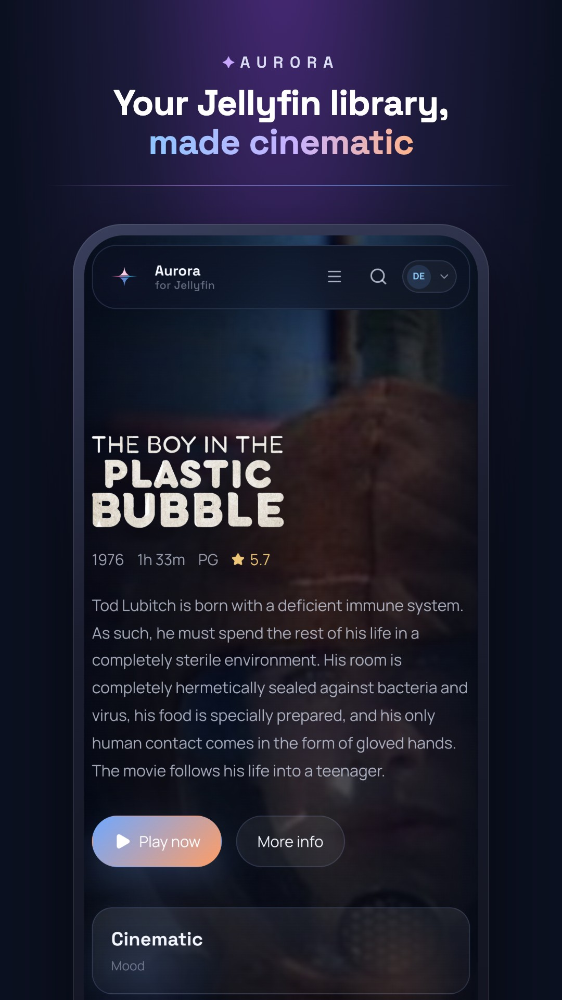
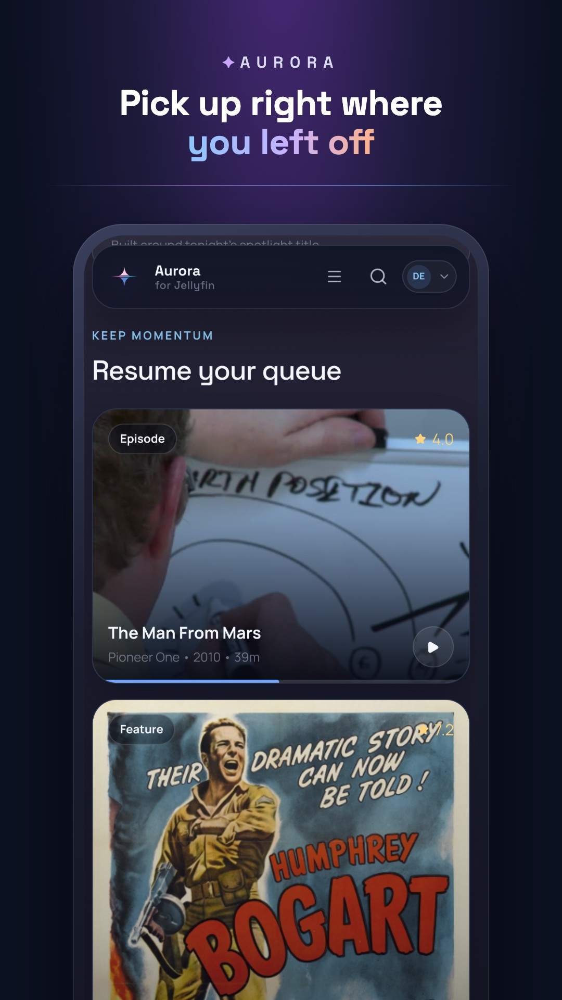
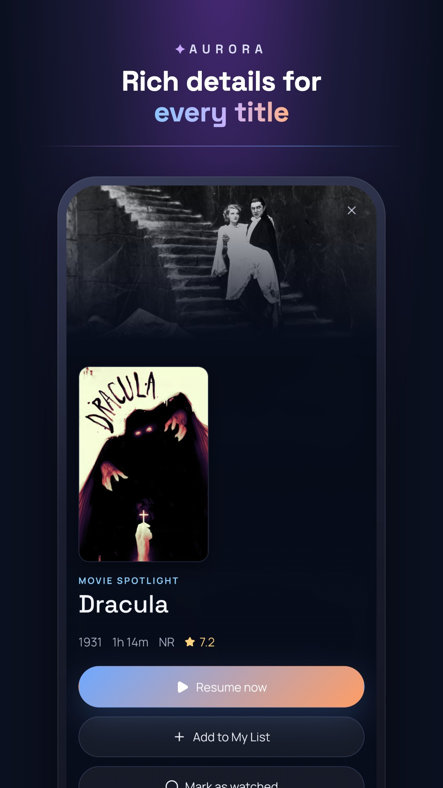
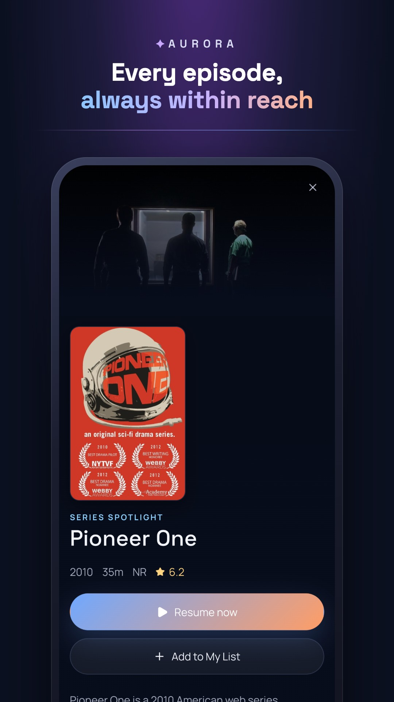
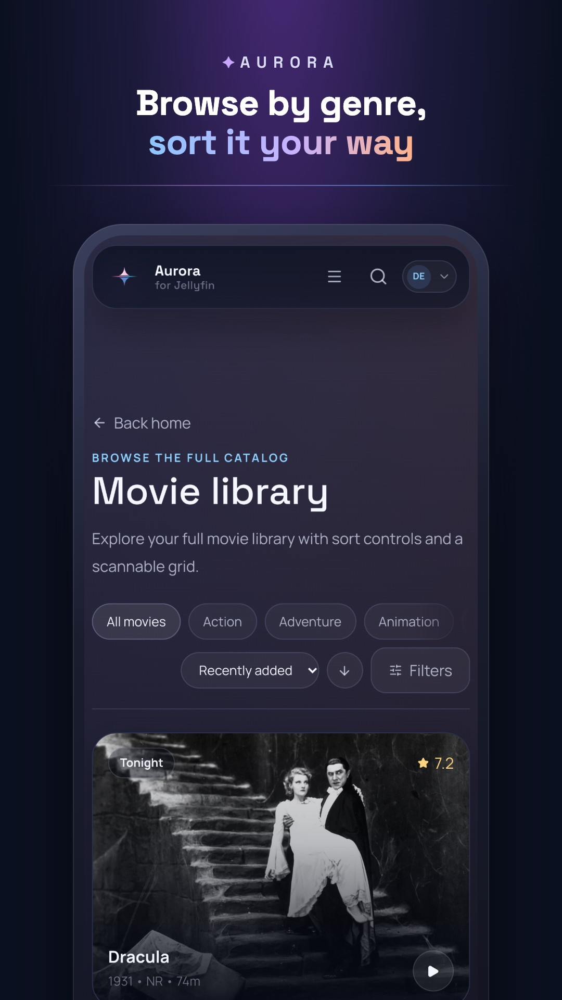
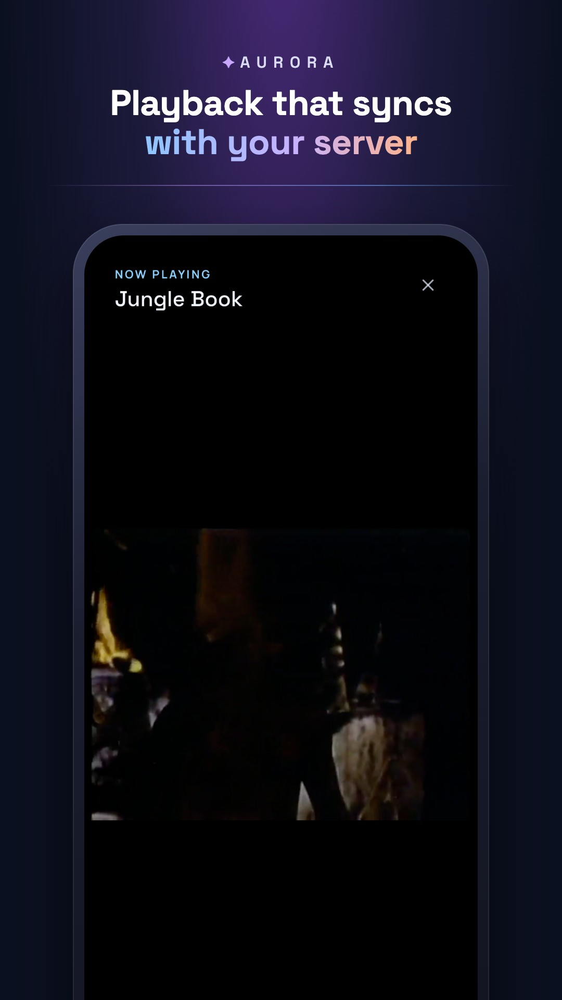

<p align="center">
  
</p>

<h1 align="center">Aurora</h1>

<p align="center">
  A cinematic, TV-friendly way to browse and watch your Jellyfin library.
</p>

<p align="center">
  <a href="https://github.com/sponsors/ElianCodes"></a>
  <a href="https://discord.gg/M3wzFpGbzp"></a>
</p>

<p align="center">
  <a href="https://play.google.com/store/apps/details?id=dev.getcoral.aurora">
    
  </a>
</p>

Aurora UI is an open-source Jellyfin frontend. It keeps Jellyfin as the source of truth and adds a living-room-ready way to browse and watch: a featured home, richer detail views, embedded playback, favorites, genre browsing, and a translation-ready UI. Self-host it, or install [Aurora Cinema on Google Play](https://play.google.com/store/apps/details?id=dev.getcoral.aurora).

Aurora is an independent project and is not affiliated with or endorsed by the Jellyfin project.

## Why Aurora

Jellyfin's web client is the server console: libraries, metadata, users, and playback in one place. Aurora is a separate frontend built for the people watching.

- **A home screen for discovery.** Featured titles, Continue Watching, favorites, and recommendation rails.
- **Detail pages for the couch.** Cast, related titles, and series episode lists, with resume-next-up.
- **Shared households.** A Netflix-style profile picker. With required sign-in, each person gets their own Jellyfin session, so playback and watch progress stay on the right account.
- **The living room.** TV mode uses larger text and simpler navigation for a remote. The player can hand the stream to a TV over AirPlay or Cast.
- **Your server, your data.** Aurora has no accounts of its own, no ads, and no tracking. It talks only to the Jellyfin server you connect, and stores that connection in a local SQLite file, so self-hosting does not need another database.

Keep Jellyfin's web client for administering the server. Open Aurora when you want to watch.

## Screenshots

<p align="center">
  
  
  
</p>
<p align="center">
  
  
  
</p>

These are the English Google Play phone screenshots shipped in [`fastlane/metadata/android/en-US/images/phoneScreenshots`](./fastlane/metadata/android/en-US/images/phoneScreenshots). Dutch listings are in [`fastlane/metadata/android/nl-NL/images/phoneScreenshots`](./fastlane/metadata/android/nl-NL/images/phoneScreenshots).

## Quick start

Docker Compose, with the in-app Jellyfin setup:

```yaml
services:
  aurora:
    image: getcoral/aurora:latest
    ports:
      - "3000:3000"
    volumes:
      - aurora-data:/data
    restart: unless-stopped

volumes:
  aurora-data:
```

```bash
docker compose up -d
```

Open [http://localhost:3000](http://localhost:3000) and complete the Jellyfin onboarding form once. Aurora persists the connection in `/data/aurora.sqlite`.

The Jellyfin URL is requested by the Aurora container, so `localhost` in that form is the container itself. Use a hostname the container can reach: another Compose service name, a LAN address, or `host.docker.internal` on Docker Desktop.

The same stack with onboarding skipped (the container image is also published as [`ghcr.io/get-coral/aurora`](https://github.com/Get-Coral/aurora/pkgs/container/aurora)):

```yaml
services:
  aurora:
    image: getcoral/aurora:latest
    ports:
      - "3000:3000"
    volumes:
      - aurora-data:/data
    environment:
      JELLYFIN_URL: http://your-jellyfin:8096
      JELLYFIN_API_KEY: your_api_key
      JELLYFIN_USER_ID: your_user_id
      JELLYFIN_USERNAME: your_username
      JELLYFIN_PASSWORD: your_password
    restart: unless-stopped

volumes:
  aurora-data:
```

`JELLYFIN_USER_ID` is the Jellyfin user UUID. More on images, the local build, and `docker run` is in [Docker](#docker).

## Highlights

- Jellyfin-powered home screen with featured, continue watching, favorites, and recommendation rails
- Embedded playback with progress sync back to Jellyfin
- Rich title detail views with cast, related titles, and series episode context
- Movie and series library pages with genre browsing, sorting, and pagination
- `My List` / favorites workflow backed by Jellyfin favorites
- Multi-user profiles with a Netflix-style profile picker for shared households
- Optional required sign-in with per-user Jellyfin sessions, so playback and watch progress are attributed to the right account
- Admin dashboard for managing users, parental controls, libraries, and active sessions
- Translation-ready UI with locale files contributors can extend
- Local-first onboarding backed by SQLite so self-hosting does not require an external database

## Stack

- [TanStack Start](https://tanstack.com/start)
- React 19
- TanStack Router + TanStack Query
- Tailwind CSS v4
- Jellyfin API

## Getting Started

Install dependencies:

```bash
pnpm install
```

Create your local env file if you want to skip the in-app setup flow during development:

```bash
cp .env.example .env
```

Fill in the Jellyfin settings in `.env`:

```bash
JELLYFIN_URL=http://localhost:8096
JELLYFIN_API_KEY=your_api_key_here
JELLYFIN_USER_ID=your_user_id_here
JELLYFIN_USERNAME=your_username_here
JELLYFIN_PASSWORD=your_password_here
```

Start the app:

```bash
pnpm dev
```

Open [http://localhost:3000](http://localhost:3000).

If you do not provide Jellyfin env vars, Aurora will open a local onboarding screen at `/setup` and store the connection details in a local SQLite file under `./data/aurora.sqlite`.

## Scripts

```bash
pnpm dev
pnpm build
pnpm start
pnpm preview
pnpm test
```

## CI

GitHub Actions workflows are included for:

- CI on pushes and pull requests: install, test, web build, Android Capacitor sync, Android debug assemble, and Docker build validation
- Docker publish to Docker Hub and GHCR on `main`, version tags, or manual dispatch

Workflow files:

- [`.github/workflows/ci.yml`](./.github/workflows/ci.yml)
- [`.github/workflows/docker-publish.yml`](./.github/workflows/docker-publish.yml)

## Local Storage

Aurora stores local app configuration in SQLite.

- Default database path: `./data/aurora.sqlite`
- Override with: `AURORA_DATA_DIR=/path/to/data`
- Main use today: persisted Jellyfin connection details for onboarding and self-hosted installs

This keeps Aurora simple to deploy on a VM or home server because there is no external database requirement.

## Jellyfin Notes

Aurora uses Jellyfin as the system of record.

- API key access is enough for browsing, favorites, and most library features
- Username/password are used to create a real Jellyfin playback session so Aurora can sync progress and watched state more reliably; with required sign-in enabled, each signed-in user's own session is used instead and the configured credentials are only the fallback
- `JELLYFIN_USER_ID` must be the actual Jellyfin user UUID, not the app name
- If you use the onboarding flow, Aurora stores these values in local SQLite instead of requiring env vars

## IPTV sources

Aurora can show IPTV next to Jellyfin, or on its own. Live channels, films and series from IPTV appear on Home, in search, in My List and in history, open in the same details view and play in the same player as Jellyfin titles.

Set `AURORA_IPTV_ORIGINS` on your Aurora server to enable IPTV. Use a comma-separated list of the origins your sources start from, for example `https://provider.example`. Include the scheme and any non-default port, with no path or credentials. Aurora only contacts a source through these origins.

Xtream providers hand every stream to load balancers whose addresses change per request. Aurora follows those redirects, HLS segments and artwork to public internet addresses and never to private, loopback or link-local networks. Set `AURORA_IPTV_STRICT_ORIGINS=true` to require every hop to be on the allowed list instead.

Add sources in **Settings → IPTV sources**. Without Jellyfin, choose **Use Aurora with IPTV only** on the setup screen. Choose:

- **Xtream Codes** with the server URL, username and password. Aurora loads live TV, films, series with seasons and episodes, film details and the TV guide through the Xtream API. A pasted Xtream M3U link (`get.php?username=…&password=…`) is turned into an Xtream source automatically. If a panel has its API turned off, Aurora reads its M3U download instead.
- **M3U playlist URL** for any other playlist. Channel numbers, logos, categories and the guide advertised in `url-tvg` are used.
- **Direct stream URL** for a single HLS, MPEG-TS or video file.

You can give a source its own XMLTV guide URL. Without one, Aurora uses the guide from the provider. Guides are read in the background, so the first page view may only show the provider's short guide.

Sources are shared by everyone using the Aurora server and can only be changed by an administrator (or by anyone before Jellyfin is set up). Aurora stores them encrypted in SQLite, with a key file it creates beside the database. An optional 64-character hexadecimal `AURORA_IPTV_SOURCE_KEY` replaces that key. Passwords and full playlist URLs never reach the browser: streams and artwork go through Aurora with signed links that survive a restart. Watch progress, history and My List for IPTV are kept per Aurora user.

Aurora plays HLS and MPEG-TS in supported browsers and falls back to the provider's HLS when an MPEG-TS channel fails. Films and episodes play when the browser supports their container and codecs. Set `AURORA_IPTV_FFMPEG` to an FFmpeg executable with H.264 and AAC encoding to play MKV and AVI, including resuming and seeking. The Docker image ships FFmpeg and sets this for you. Aurora looks inside each file with `ffprobe` (found beside FFmpeg, or set `AURORA_IPTV_FFPROBE`): H.264 video is repackaged rather than re-encoded, which costs little CPU and keeps the original quality, and other video is converted. The player then offers the file's audio tracks and its text subtitles (SubRip, ASS, WebVTT), which the same conversion writes out, so films with several languages or "MULTI SUB" releases play in the language you choose. This mode handles one conversion at a time per Aurora process, which matches most IPTV accounts' single-connection limit.

Administrators can choose per source which categories appear (**Categories** next to a source); adult content stays hidden unless a source allows it. The source list also shows the subscription's expiry date and connection limit when the provider reports them.

**Live TV** lists every channel with what's on now, a **TV guide** timeline, and the films and series of your sources. While watching a channel, step to the previous or next one with the arrow keys, page up/down, a remote's channel keys or the on-screen buttons. A channel's details show the day's guide; on Xtream channels with an archive, earlier programmes have **Watch back** and play from the provider's catch-up (timeshift), seekable.

Search covers Jellyfin and IPTV together: films, series, episodes, collections and people from Jellyfin, and channels, titles, series cast and the TV guide from IPTV, ranked as one result and grouped by kind. Matching ignores accents and word order and tolerates small typos. Press Enter in the header search for the full results page.

In the Android and iOS apps, sources are kept on the device and the app talks to the provider directly. Live channels use the provider's HLS. Raw MPEG-TS playlists and MKV files can't play there.

## User Profiles

Aurora supports multiple profiles for shared households: everyone picks their own Jellyfin user on a profile screen when opening Aurora.

- Enable it in Settings → User profiles, or force it on with `AURORA_MULTI_USER=true` in the environment
- Administrators manage users (create, disable, delete, parental controls) from the dashboard at `/admin`
- When required sign-in is enabled, switching to another profile asks for that profile's password

## Requiring Sign-In

By default anyone who can reach your Aurora instance can browse and stream the connected library. If your instance is reachable from the internet (or any network you do not fully trust), enable **Require sign-in** in Settings → Security. Everyone then has to sign in with their own Jellyfin username and password before Aurora serves anything.

- Sessions are stored server-side in the local SQLite database and last 30 days
- Sign-in is validated directly against your Jellyfin server, so Jellyfin account lockout policies apply
- Each sign-in gets its own Jellyfin access token, so playback and watch progress are attributed to the signed-in user (not the configured account), and signing out revokes the token on the Jellyfin side
- To force it on (so it cannot be disabled from the UI), set `AURORA_REQUIRE_LOGIN=true` in the environment

Administration is gated separately and always requires signing in. Even on an open
instance, the admin dashboard and the settings that change your Jellyfin connection,
users, or security options are only available to a signed-in Jellyfin administrator —
"Require sign-in" controls who can browse and stream, not who can administer. The one
exception is a brand-new install that is not connected to Jellyfin yet, since there is
no account to sign in with until setup completes.

## Playing on a TV (AirPlay & Cast)

The player has a "Play on TV" button that opens the browser's own device picker — AirPlay in Safari and on iOS, Cast in Chrome. It only appears once a receiver has been discovered, so give it a second or two on first load.

A TV doesn't play the video through your browser: it's handed the stream URL and fetches it itself. That has a few consequences worth knowing:

- **Aurora has to be reachable from the TV.** `http://localhost:3000` cannot work — serve Aurora on a hostname or IP the receiver can also reach.
- **Cast needs HTTPS.** Chrome only exposes the picker on a secure origin. AirPlay has no such requirement and works over plain HTTP on a LAN.
- **Subtitles stay on your device.** The receiver plays the stream as its own player, so neither Aurora's subtitle tracks nor the OpenSubtitles overlay reach the TV.
- **Quality is fixed for the duration of the cast**, and seeking is limited to what's already buffered — changing either would restart the stream and drop the connection to the TV.

With **Require sign-in** on, stream URLs are signed with a token so the TV can fetch them without your session cookie. Each token covers a single title, expires within six hours, and stops working the moment you sign out. Aurora generates the signing secret on first use; set `AURORA_STREAM_TOKEN_SECRET` only if you run several replicas behind a load balancer.

## Translations

Translations live in dedicated locale files so contributors can add languages without touching the runtime logic.

Files:

- [`src/lib/i18n/messages/en.ts`](./src/lib/i18n/messages/en.ts)
- [`src/lib/i18n/messages/nl.ts`](./src/lib/i18n/messages/nl.ts)
- [`src/lib/i18n/messages/index.ts`](./src/lib/i18n/messages/index.ts)

To add a new language:

1. Copy `src/lib/i18n/messages/en.ts` to a new file such as `fr.ts`
2. Translate the strings
3. Export and register the file in `src/lib/i18n/messages/index.ts`
4. Add the locale to the language picker if you want it selectable in the UI

## Docker

Aurora ships with a production Dockerfile and can be deployed to a VM with Docker or Docker Compose. The copy-paste Compose files are in [Quick start](#quick-start).

Build locally:

```bash
docker build -t aurora .
```

Run locally with the onboarding flow:

```bash
docker run --rm -p 3000:3000 \
  -v aurora-data:/data \
  getcoral/aurora:latest
```

Then open [http://localhost:3000](http://localhost:3000) and complete the Jellyfin onboarding form once. Aurora will persist the connection in `/data/aurora.sqlite`.

If you prefer skipping onboarding, you can still pass the Jellyfin env vars directly:

```bash
docker run --rm -p 3000:3000 \
  -v aurora-data:/data \
  -e JELLYFIN_URL=http://your-jellyfin:8096 \
  -e JELLYFIN_API_KEY=your_api_key \
  -e JELLYFIN_USER_ID=your_user_id \
  -e JELLYFIN_USERNAME=your_username \
  -e JELLYFIN_PASSWORD=your_password \
  getcoral/aurora:latest
```

The container listens on port `3000` and stores local config in `/data`.

## Capacitor Wrappers

Aurora now supports a real local Capacitor build for Android and iOS.

How it works:

- Capacitor uses the built local web bundle from `dist/client`.
- TanStack Start SPA mode now emits a real `dist/client/index.html`, which Capacitor requires.
- `pnpm cap:sync`, `pnpm cap:copy`, and `pnpm cap:run:*` build Aurora first and then sync the native projects.
- In native-shell mode, Aurora stores Jellyfin and OpenSubtitles settings in device-local storage instead of relying on the Node server.
- Android hardware back now exits fullscreen first, then closes Aurora overlays, then navigates back before exiting the app at the true root.

The Capacitor config lives in [`capacitor.config.ts`](./capacitor.config.ts).

### Native Setup

Sync the latest web assets into Android and iOS:

```bash
pnpm cap:sync
```

Open the native projects:

```bash
pnpm cap:open:android
pnpm cap:open:ios
```

Run directly to a connected device or emulator:

```bash
pnpm cap:run:android
pnpm cap:run:ios
```

Build the Android debug app without launching a device target:

```bash
pnpm android:assemble:debug
```

### First Launch

On first launch in the native app:

1. Open the `/setup` flow.
2. Enter the Jellyfin server URL.
3. Either leave the API key empty and sign in with your Jellyfin username and password (the password may be empty for accounts without one), or enter an API key together with your user ID, username, and password.
4. Optionally add your OpenSubtitles API key in settings.

Aurora stores that configuration on the device.

### What Works Locally

- Setup and settings
- Home feeds
- Movie and series library browsing
- Search
- My List and favorites toggles
- History
- Media details and episode browsing
- Basic local playback bootstrapping
- OpenSubtitles search and download using the stored API key

### Current Limits

- The admin screen is still server-oriented.
- Native playback works locally, but full Jellyfin playback-session and progress sync is still less complete than the hosted server build.
- If you want the native shell to target a hosted Aurora deployment instead, you can still set `AURORA_APP_URL` before syncing.

Example hosted override:

```bash
AURORA_APP_URL=https://your-aurora-domain.example pnpm cap:sync
```

### Android Release Builds

The Play Store bundle is signed with an upload key that never goes in the repo. Copy [`android/keystore.properties.example`](./android/keystore.properties.example) to `android/keystore.properties` and point it at your keystore, or set the `AURORA_UPLOAD_STORE_FILE`, `AURORA_UPLOAD_STORE_PASSWORD`, `AURORA_UPLOAD_KEY_ALIAS` and `AURORA_UPLOAD_KEY_PASSWORD` environment variables. Then build the bundle:

```bash
pnpm android:bundle:release
```

The signed bundle is written to `android/app/build/outputs/bundle/standardRelease/app-standard-release.aab`. Without a keystore the release build is left unsigned.

The version comes from `package.json`. The versionCode is `major * 1000000 + minor * 10000 + patch * 100 + build`, so 1.14.1 becomes `1140100`. To upload the same version again, raise the build number with `AURORA_BUILD_NUMBER` (0–99), for example `AURORA_BUILD_NUMBER=1 pnpm android:bundle:release`.

Store listing texts, release notes, the icon, the feature graphic, the TV banner and the phone, tablet and TV screenshots live in [`fastlane/metadata/android`](./fastlane/metadata/android). The phone, tablet and TV screenshots all come from [`scripts/store/screenshots.mjs`](./scripts/store/screenshots.mjs), which runs the built app as the Android app does (on-device runtime, TV mode at 1080p) against the public Jellyfin demo server, whose films are all public domain or Creative Commons. Run `pnpm store:screenshots` to make them again (add `-- --only phone`, `tablet` or `tv` for one kind); uploading them to the Play Console is still a manual step. The privacy policy is in [`docs/privacy-policy.md`](./docs/privacy-policy.md) and is published at https://getcoral.dev/apps/aurora/privacy.

### Meta Quest Builds

The Android project has two product flavors. `standard` is the Play Store app for phones, tablets and TVs. `quest` is the Meta Horizon Store build: the same app as a 2D panel. Its manifest additions live in [`android/app/src/quest/AndroidManifest.xml`](./android/app/src/quest/AndroidManifest.xml): supported headsets, a 16:9 panel size, and no TV banner or leanback entry. In the web app, a Quest reports the `quest` platform (see `src/lib/platform.ts`).

To try it on a headset, turn on developer mode for the Quest in the Meta Horizon phone app, connect it over USB-C (or wireless adb), and run:

```bash
pnpm android:quest:install
```

Meta Quest Developer Hub can show the headset view on your computer, and `chrome://inspect` debugs the WebView as on any Android device.

For the store, `pnpm android:quest:release` builds a signed APK (the same keystore setup as above) at `android/app/build/outputs/apk/quest/release/app-quest-release.apk`. Upload it to a release channel with Meta's `ovr-platform-util`:

```bash
ovr-platform-util upload-quest-build --app-id <APP_ID> --app-secret <APP_SECRET> \
  --apk android/app/build/outputs/apk/quest/release/app-quest-release.apk --channel ALPHA
```

#### Theater environments

On the Quest, "Watch in the theater" opens an immersive player (Meta Spatial SDK) in one of several environments. Their images, seats and sounds are committed files in `android/app/src/quest/`, so building the app never needs Blender. They are made by the scripts in [`scripts/quest`](./scripts/quest), which you only run to change or add an environment:

- `blender/env_<name>.py` builds a room in Blender, entirely from code; `blender/render_env.py` renders it as a 360° panorama with its light layers and exports the viewer's seat as glTF: `blender -b --factory-startup -P scripts/quest/blender/render_env.py -- <name>` (add `--preview` for a quick look).
- `compose.py <name>` turns the renders into the app's sky and additive light-layer textures.
- `ambience.py` synthesises the ambient sound loops; `environments.py` paints the older northern lights and dark room skies; `icons.mjs` converts the Lucide icons the native controls use.
- An environment is registered in [`TheaterEnvironments.kt`](./android/app/src/quest/java/dev/getcoral/aurora/TheaterEnvironments.kt), with how each light layer behaves while the film plays.

The Horizon Store listing (texts, images and the answers for the submission form) lives in [`store/horizon`](./store/horizon); `scripts/quest/store_assets.py` makes its images from the environments.

The public Android app is [Aurora Cinema](https://play.google.com/store/apps/details?id=dev.getcoral.aurora) (`dev.getcoral.aurora`).

### Packaging Notes

- Android release bundles are built with `pnpm android:bundle:release` (see above). Android Studio is still useful for running and debugging.
- iOS (iPhone and iPad, `dev.getcoral.aurora`, team `N5YCFWUSWU`): the version comes from `package.json` at build time, with the same build number as Android's versionCode (`AURORA_BUILD_NUMBER` raises it for a re-upload), and `ITSAppUsesNonExemptEncryption` is set, so App Store Connect doesn't ask about encryption for each build. After `pnpm build && npx cap sync ios`, archive and upload to App Store Connect (TestFlight) with Xcode → Product → Archive → Distribute App, or from the command line:

  ```bash
  cd ios/App
  xcodebuild -project App.xcodeproj -scheme App -configuration Release \
    -destination "generic/platform=iOS" -archivePath build/Aurora.xcarchive \
    -allowProvisioningUpdates archive
  xcodebuild -exportArchive -archivePath build/Aurora.xcarchive \
    -exportOptionsPlist ExportOptions.plist -exportPath build/export -allowProvisioningUpdates
  ```

  where `ExportOptions.plist` sets `method` to `app-store-connect`, `destination` to `upload` and `teamID` to `N5YCFWUSWU`.
- The same Android build runs on Android TV and Google TV. It appears in the TV launcher (`LEANBACK_LAUNCHER`, with the banner in `res/drawable-xhdpi/tv_banner.png`) and asks the system whether it runs on a TV, so TV mode switches on even when the WebView's user agent doesn't mention one. To ship it to TVs, opt in to the Android TV form factor in the Play Console (Release → Advanced settings → Form factors); the TV screenshots and the store banner are in `fastlane/metadata/android/*/images` (`tvScreenshots`, `tvBanner.png`), and Google reviews TV apps separately before they show up on TVs.
- To try the TV build, create an Android TV device in Android Studio's Device Manager (Television, 1080p) and run `pnpm cap:run:android` with it selected. In a desktop browser, Settings → TV mode gives the same layout, driven with the arrow keys and Enter.
- On a TV the remote does everything: the arrows move between controls, OK opens a text field's keyboard (fields reached with the arrows keep it closed, so it doesn't take over the remote), Back goes back, and in the player Up/Down and the channel keys zap through live channels.
- Capacitor Android 8 requires JDK 21 for local and CI builds.
- `pnpm cap:run:android` resolves `JAVA_HOME` automatically on macOS and prefers the Homebrew JDK 21 path when present, then falls back to system JDK 21 or 17.
- CI validates the native Android path with `pnpm cap:sync` and `pnpm android:assemble:debug`.

Published images go to:

- [`getcoral/aurora`](https://hub.docker.com/r/getcoral/aurora) on Docker Hub
- [`ghcr.io/get-coral/aurora`](https://github.com/Get-Coral/aurora/pkgs/container/aurora) on GHCR

## Desktop App (macOS & Windows)

The desktop app is built with [Tauri](https://tauri.app). It runs the Aurora server on `127.0.0.1` next to the app, on the Node.js build it ships with, and shows it in a native window (WKWebView on macOS, WebView2 on Windows). So it has everything a server install has: ffmpeg remuxing for MKV and raw MPEG-TS, audio and subtitle tracks, the TV guide cache, and IPTV providers without CORS limits. Settings and caches live in the app's data folder (`~/Library/Application Support/dev.getcoral.aurora` on macOS, `%APPDATA%\dev.getcoral.aurora` on Windows).

The server only answers the app's own window: it checks the Host header, and the window gets a secret for each launch that the server sets as a SameSite=Strict cookie (see [`desktop-guard.mjs`](./desktop-guard.mjs)), so web pages in your browser can't use it. In the desktop app IPTV can reach any provider you add, also one on your own network, as in the mobile apps.

```bash
pnpm desktop:dev    # run it in development
pnpm desktop:build  # build the installers for this machine (.app/.dmg on macOS, .exe/.msi on Windows)
```

You need [Rust](https://rustup.rs) and, on Windows, the Visual Studio C++ build tools. Before each build, [`scripts/desktop/prepare.mjs`](./scripts/desktop/prepare.mjs) builds the web app, bundles the server into one file, and downloads the matching official Node.js build (checked against nodejs.org's checksums). The Windows build also bundles ffmpeg (the LGPL build from [BtbN/FFmpeg-Builds](https://github.com/BtbN/FFmpeg-Builds)); on macOS the app uses an installed ffmpeg (`brew install ffmpeg`) when there is one.

The [Desktop workflow](./.github/workflows/desktop.yml) builds macOS and Windows installers on every change to the desktop code.

To sign the Mac app, create a Developer ID Application certificate (Xcode → Settings → Accounts → your team → Manage Certificates → + → Developer ID Application). Locally, pass it to the build and add Apple ID details to notarize:

```bash
APPLE_SIGNING_IDENTITY="Developer ID Application: Your Team (TEAMID)" \
APPLE_ID=you@example.com APPLE_PASSWORD=app-specific-password APPLE_TEAM_ID=TEAMID \
pnpm desktop:build
```

The app runs with the hardened runtime; [`src-tauri/Entitlements.plist`](./src-tauri/Entitlements.plist) allows the JIT the bundled Node.js needs. In CI, set the secrets `APPLE_CERTIFICATE` (the certificate exported as a .p12, base64-encoded), `APPLE_CERTIFICATE_PASSWORD`, `APPLE_SIGNING_IDENTITY`, `APPLE_ID`, `APPLE_PASSWORD` and `APPLE_TEAM_ID`; without them the Mac build is unsigned. The Windows installers aren't signed yet, so Windows shows a SmartScreen warning on first launch.

An Apple TV app isn't possible this way: tvOS has no web view, so it would need a separate native app.

## Contributing

Issues and pull requests are welcome.

If you want to contribute:

1. Fork the repo
2. Create a branch
3. Make your changes
4. Run `pnpm build`
5. Open a pull request

## Sponsoring

If Aurora helps you or you want to support ongoing work, you can sponsor the project here:

- [GitHub Sponsors: ElianCodes](https://github.com/sponsors/ElianCodes)

## License

Aurora UI is released under the [MIT License](./LICENSE).
